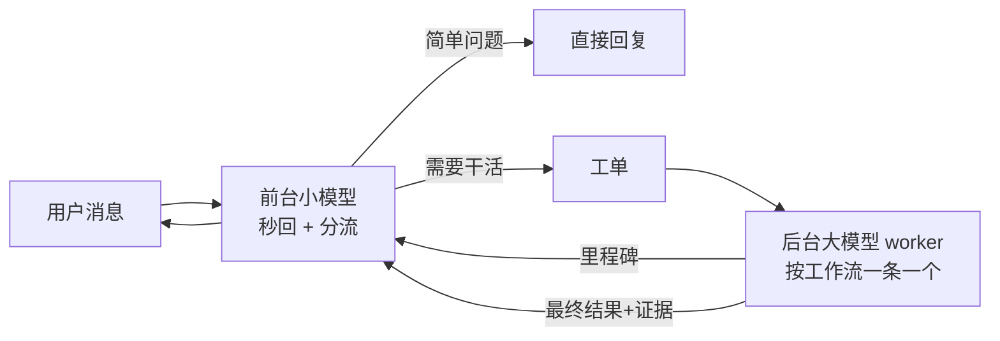

# Minis 体验升级方案：前台秒回 + 后台干活

> 状态：**用户已在本次会话批准实施（含可选项和进阶项）**。本文作为需求基线；实现与验证状态以实际证据为准。按惯例：每项必须端到端测试通过才算完成；密钥和个人信息不进安装包、代码、CI 或 GitHub。

## 1. 目标
用起来「舒服」主要是这几点：
- 发出去马上有回应，不用盯着转圈等。
- 长任务在后台跑，聊天不会被卡住，期间可以继续说话、插话、叫停。
- 只在关键节点汇报进度，不刷屏。
- 结果直接做成可点开的卡片（文件、链接、IPA、图片）。
- 说「做完了」之前一定先验证过。

## 2. 总体架构


## 3. 分配流程（每条消息）
1. **立刻回应**（目标 1 秒内出首字）：能直接答的就答完；要干活的先回一句「在做 X，第一步是 Y」。
2. **分流判断**：
   - 闲聊、简单问答 → 前台直接回复。
   - 多步任务（写代码、查资料、处理文件、操作云电脑）→ 生成工单交给后台。
3. **工单格式**（固定 JSON，字段齐全才派出）：
   ```json
   {"workstream":"openminis-ui","goal":"…","context":"相关偏好/历史","success_criteria":["…"],"report_back":"要交回什么"}
   ```
4. **复用 worker**：同一件事的追问、修改、纠错发给原来那个 worker，不新开；同时活跃的 worker 一般 1–2 个，上限约 4 个。
5. **进度汇报**：只在结果、决定、卡住、改计划这几种节点由前台转述一句；不逐条播报命令。
6. **插话 / 叫停**：用户新消息先到前台；属于某个任务的修改就塞进该 worker；说「停」就停掉全部 worker 和它们开的后台任务，并报告停了什么。
7. **交付**：worker 返回结果和证据（测试结果、截图、文件路径），前台用简短的话加卡片交付；没验证过的只说「已起草 / 待测试」，不说「完成」。
8. **队列**：用一个待办清单记录每个请求的状态（排队 / 进行中 / 已交付），每次收到新消息或任务完成时对一遍账。

## 4. 模型搭配
| 角色 | 候选 | 要求 |
|---|---|---|
| 前台 | DeepSeek 4.1 flash、Gemini 3.5 Flash Lite、百炼 Qwen Flash/Turbo | 首字 <1 秒；分流准；工单 JSON 稳定 |
| 后台 | GPT 6（OpenAI 官方 API） | 长任务能力、工具调用稳；注意费用 |

型号我没法逐一核实，**上线前必须实测**：拿 20 条自己的真实消息，各候选跑一遍，比较首字速度、分流准确率、工单格式出错率。走中转的话先让「验模员」检查有没有掺水。Gemini 在国内可能需要代理，会拖慢首字速度。

## 5. Minis 需要的改动清单
- **设置页**：分开填写「前台模型」「后台模型」（地址、模型名；密钥只存在手机钥匙串里）。
- **服务端 agent**：前台循环（秒回+分流）、worker 管理（创建/复用/插话/停止）、工单与进度事件。
- **聊天 UI**（沿用已确认的需求）：
  - 点发送立刻显示已发出，不显示「发送中」，真失败才出红色重试。
  - 简单模式不显示思考和工具步骤（放到后台详情里）；灰色气泡、右侧留白。
  - 复制 / emoji / 回复图标和首字、总时长、tokens 默认隐藏，点消息旁空白处才展开。
  - 交付物用可点开的卡片展示（D1–D6）。
- **后台任务面板**：显示每个 worker 的状态、最近步骤、停止按钮。
- **完成定义**：worker 交付时必须带验证证据，前台按证据选择措辞。

## 6. 加分项（可选，逐项批准）
- 一句话把重复任务变成定时任务（routine）。
- 「刚才那个」指代上一个结果。
- 任务时间线、离线排队发送、值班模式（只给结论和剂量单位，不主动打扰）。
- Bot 模板导入导出（profile + 记忆 + 技能 + 首次引导，打包成 JSON/zip）。

## 6.5 进阶建议（待批准，逐项决定）
1. **派活前先对齐**：前台派工单前用一句话复述「我理解你要 X，完成标准是 Y」，用户可当场纠正，避免后台白跑。
2. **记忆分层**：长期偏好（中文、简短、值班只要结论）、项目记忆、当天流水三层；前台每次只带相关几条进上下文，快且不跑偏。
3. **教训自动入库**：用户批评过的问题（如「没测就说完成」）自动记成规则，之后派活时附进工单，同样的错不犯第二次。
4. **花费护栏**：每个任务先估 tokens 和费用，超预算就停下来问；设置页显示当天花费。
5. **断点续跑**：后台任务在每个里程碑存检查点；断网、App 被杀、服务端重启后从上一步继续。
6. **完成前自查**：后台交付前由一个便宜模型对照验收标准检查，不合格退回重做，用户只看合格结果。
7. **语音直通前台**：一句语音即可派活，前台用语音回「收到，在做」，适合开车、查房。
8. **主动但克制**：只在完成、卡住、需要拍板时推送通知；支持值班免打扰时段。

## 7. 验收标准
- 模拟器 XCUITest 连真实服务端 + 假模型，覆盖：秒回、派活、进度、插话、叫停、卡片交付；附截图。
- iOS 构建和 XCUITest 只在自托管 runner Mac-58 上跑（`runs-on: [self-hosted, macOS, openminis-mac]`），一次一个 Mac 任务，触发前先确认 runner 在线。
